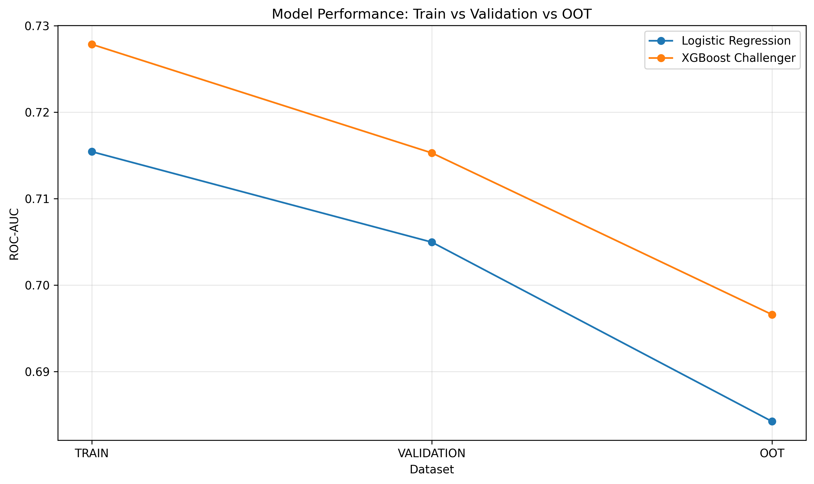
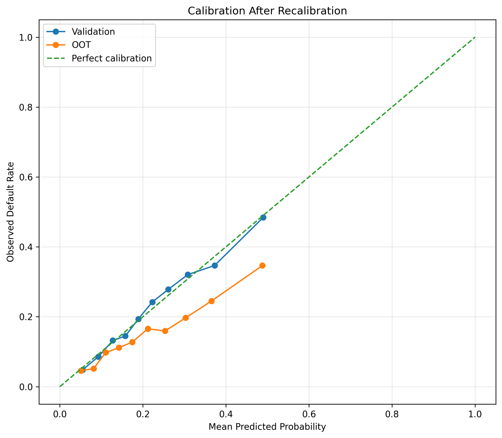
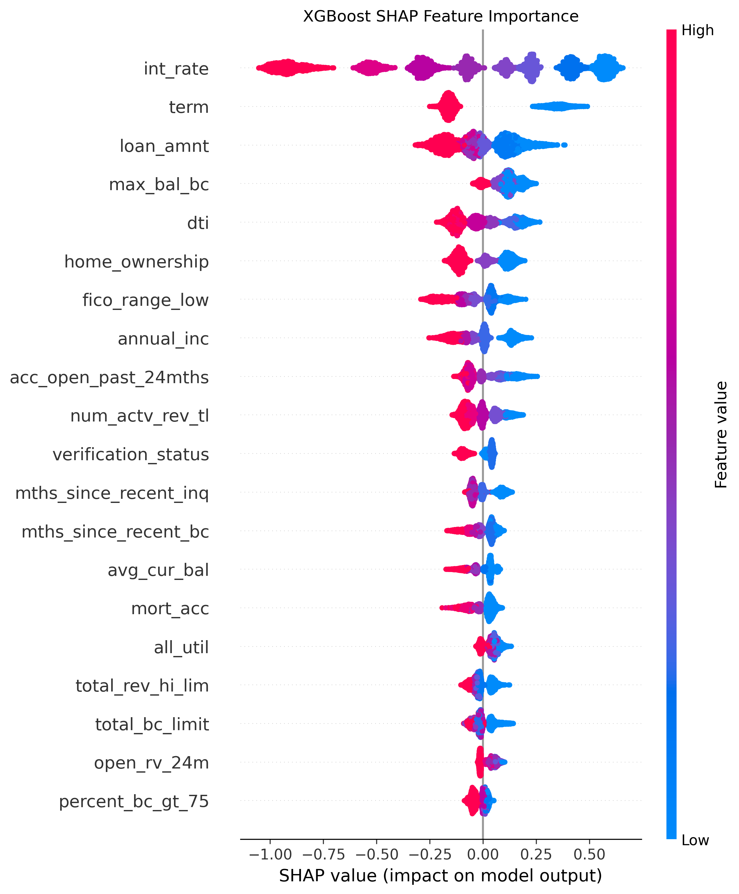
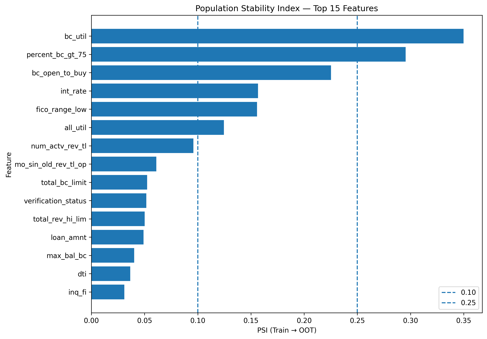
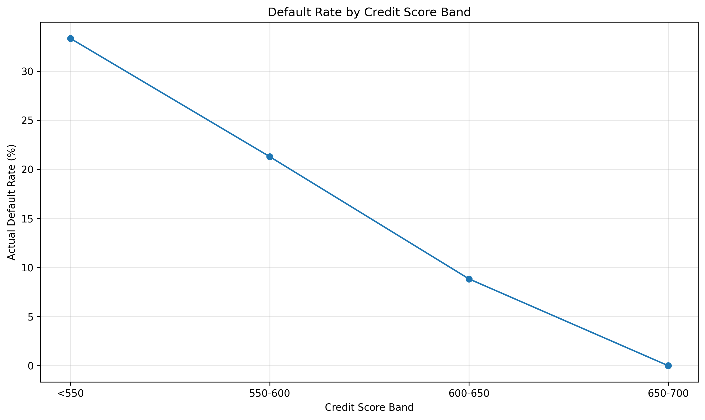

# Credit Default Risk Modeling & Scorecard Development


An end-to-end credit risk modeling pipeline that estimates borrower probability of default (PD) at loan origination on LendingClub data (`2007–2018`) and translates model log-odds into an interpretable, points-based credit scorecard. The workflow pairs statistical quantile binning, two-proportion z-test merging, and monotonic Weight of Evidence (WoE) logistic regression with an XGBoost challenger (`0.7153` validation ROC-AUC, `0.4306` Gini), SHAP attribution, Population Stability Index (PSI) drift monitoring, and validation-fitted logit recalibration.

---

## Project Highlights

- **Dataset & Leakage Control:** Filtered LendingClub originations (`2007–2018`) to `119,371` resolved loans, stripped `35` post-origination repayment and recovery variables to prevent target leakage, and enforced a chronological out-of-time split (`<= 2016` Train, `2017` Validation, `2018` OOT).
- **Statistical Feature Engineering:** Built automated 8-quantile binning with two-proportion z-test merging (`|z| <= 2.0`) and monotonic default-rate constraints across `77` numerical features, narrowing the feature space to `34` low-collinearity predictors (`VIF < 8.0`).
- **Champion vs. Challenger Modeling:** Benchmarked an interpretable L2 WoE Logistic Regression champion (`intercept = -1.4084`, `34` predictors) against a shallow XGBoost challenger (`0.7153` validation ROC-AUC, `0.4306` Gini) explained via `TreeExplainer` SHAP values on the 2018 OOT cohort.
- **Calibration, PSI & Scorecard Scaling:** Fitted a univariate logit recalibration model on Validation (`intercept = -0.0974`, `slope = 0.9391`), audited feature drift across cohorts via PSI, and scaled logistic weights into a `600`-base, `20`-PDO (`4:1` base odds) credit scorecard with monotonic default-rate separation across score bands.

---

## Modeling Pipeline & Methodology

### 1. Data Preparation & Out-of-Time Split
Ongoing loans (`Current`, `In Grace Period`, `Late`) are excluded so target labels reflect final loan resolution across **119,371 resolved loans**:
- **Good (`default_flag = 0`):** `Fully Paid` and `Does not meet the credit policy. Status:Fully Paid`
- **Bad (`default_flag = 1`):** `Charged Off`, `Does not meet the credit policy. Status:Charged Off`, and `Default`

Identifier fields (`id`, `member_id`, `url`, `desc`) and `35` post-origination variables (payment totals, recoveries, collection fees, `last_fico_range_*`, hardship, and debt settlement fields) are dropped prior to splitting by origination date (`issue_d`):

| Split | Origination Window | Date Range | Loans | Good (`0`) | Bad (`1`) | Default Rate |
| :--- | :--- | :--- | ---: | ---: | ---: | ---: |
| **Train** | `issue_d.year <= 2016` | `2007-06-01` – `2016-12-01` | 99,443 | 79,871 | 19,572 | 19.68% |
| **Validation** | `issue_d.year == 2017` | `2017-01-01` – `2017-12-01` | 14,909 | — | — | — |
| **OOT Test** | `issue_d.year == 2018` | `2018-01-01` – `2018-12-01` | 5,019 | — | — | — |

Missingness on credit bureau variables is treated as informative signal rather than imputed: `13` secondary-applicant columns that are 100% missing in Train (`revol_bal_joint` and `12` `sec_app_*` fields) are excluded, while partially missing features assign `NaN` observations to a dedicated `"Missing"` bin.

### 2. Monotonic Binning, WoE & Feature Selection
Each numerical predictor is initialized into `8` quantile bins on non-missing training data (`[-inf, ..., +inf]`) and refined in two stages:
1. **Statistical significance merging:** Adjacent bins are iteratively merged when a two-proportion z-test on bin default rates yields $|z| \le 2.0$.
2. **Monotonicity enforcement:** Dominant risk direction (`increasing` or `decreasing`) is inferred from the correlation between bin order and default rate, and violating adjacent bins are merged until default rates are strictly monotonic.

Weight of Evidence (WoE) and Information Value (IV) are learned **strictly on Train** with `0.5` Laplace smoothing across $B$ bins:

$$\text{WoE}_i = \ln\!\left(\frac{(\text{Good}_i + 0.5) / (\text{Good}_{\text{total}} + 0.5 B)}{(\text{Bad}_i + 0.5) / (\text{Bad}_{\text{total}} + 0.5 B)}\right), \qquad \text{IV} = \sum_{i=1}^{B} \left(\text{Dist}_{\text{Good}, i} - \text{Dist}_{\text{Bad}, i}\right) \cdot \text{WoE}_i$$

Candidate predictors are filtered down to **34 final features** (`31` numerical, `3` categorical: `term`, `home_ownership`, `verification_status`) by removing:
- **Unpredictive features (`IV < 0.02`):** `39` low-IV numerical variables and low-IV categoricals (`purpose`, `addr_state`, `emp_length`, `disbursement_method`, `application_type`, `verification_status_joint`, `initial_list_status`, `pymnt_plan`, `policy_code`).
- **High-cardinality / date categoricals:** `emp_title` (`45,690` levels), `title` (`7,760` levels), `zip_code` (`879` levels), `earliest_cr_line`, and `issue_d`.
- **Collinear pairs (`|r| > 0.90`):** Raw-correlated numericals (`fico_range_high`, `funded_amnt`, `funded_amnt_inv`, `installment`, `num_rev_tl_bal_gt_0`, `tot_cur_bal`) and WoE-correlated features (`grade` `r = 0.9454` and `sub_grade` `r = 0.9592` with `int_rate`; `open_il_24m` `r = 0.9225` with `open_il_12m`).
- **Variance Inflation Factor (VIF) check:** All `34` retained WoE predictors satisfy $\text{VIF} < 8.0$ (maximum `7.87` on `open_rv_12m`).

| Rank | Feature | Type | Train IV | IV Strength | Final WoE VIF |
| ---: | :--- | :--- | ---: | :--- | ---: |
| 1 | `int_rate` | Numerical | 0.4435 | Strong | 1.81 |
| 2 | `term` | Categorical | 0.1960 | Medium | 1.49 |
| 3 | `fico_range_low` | Numerical | 0.1155 | Medium | 1.72 |
| 4 | `acc_open_past_24mths` | Numerical | 0.0776 | Weak | 2.86 |
| 5 | `dti` | Numerical | 0.0683 | Weak | 1.33 |
| 6 | `verification_status` | Categorical | 0.0586 | Weak | 1.11 |
| 7 | `num_tl_op_past_12m` | Numerical | 0.0577 | Weak | 2.83 |
| 8 | `bc_open_to_buy` | Numerical | 0.0502 | Weak | 5.45 |

### 3. Champion vs. Challenger & Calibration
- **Champion (WoE Logistic Regression):** L2-regularized `LogisticRegression(max_iter=1000)` fitted on the `34` WoE predictors (`intercept = -1.408380`, converged in `24` iterations), evaluated across Train, Validation, and OOT via ROC-AUC, Gini ($2 \cdot \text{AUC} - 1$), KS, and classification metrics at a `0.35` PD threshold.
- **Challenger (XGBoost + SHAP):** `XGBClassifier(n_estimators=300, max_depth=3, learning_rate=0.05, subsample=0.8, colsample_bytree=0.8)` trained on the same `34` WoE features, reaching **0.7153 Validation ROC-AUC** (**0.4306 Gini**) and interpreted on the `5,019`-loan OOT set using `shap.TreeExplainer`.
- **Logit Recalibration:** To align predicted PDs with out-of-sample default rates without altering rank-order discrimination, predicted PDs are mapped to log-odds $\text{logit}(p) = \ln(p / (1 - p))$ and recalibrated via a univariate `LogisticRegression(C=1e6)` fitted on **Validation only** (`intercept = -0.097445`, `slope = 0.939072`).

### 4. Population Stability Monitoring (PSI)
Distributional drift from Train (`<= 2016`) to Validation (`2017`) and OOT (`2018`) is quantified across all `34` features using 10 train-quantile breakpoints for numerical features and category shares for categorical features:

$$\text{PSI} = \sum_{i} \left(\text{Actual}_i - \text{Expected}_i\right) \cdot \ln\!\left(\frac{\text{Actual}_i}{\text{Expected}_i}\right)$$

Each predictor is flagged under standard credit governance thresholds: **Stable** (`PSI < 0.10`, `28` of `34` features on OOT), **Moderate shift** (`0.10 <= PSI < 0.25`, `4` features: `bc_open_to_buy`, `int_rate`, `fico_range_low`, `all_util`), and **Significant shift** (`PSI >= 0.25`, `2` revolver utilization features: `bc_util` and `percent_bc_gt_75`).

### 5. Credit Scorecard Scaling
Champion logistic regression coefficients ($\beta_j$) are converted into an additive points system anchored at `BASE_SCORE = 600`, `PDO = 20` (points to double the odds), and `BASE_ODDS = 4` (`4:1` Good:Bad):

$$\text{Factor} = \frac{\text{PDO}}{\ln(2)} \approx 28.8539, \qquad \text{Offset} = \text{BASE\_SCORE} + \text{Factor} \cdot \ln(\text{BASE\_ODDS}) = 640.0$$

$$\text{Score per WoE}_j = -\text{Factor} \cdot \beta_j, \qquad \text{Points}_{j, b} = \text{WoE}_{j, b} \cdot \text{Score per WoE}_j$$

Borrowers are scored across bin-level lookup tables and grouped into 50-point score bands (`<550`, `550-600`, `600-650`, `650-700`, `700-750`, `750+`) to verify monotonic default-rate decay as credit scores increase.

---

## Key Visual Results

### Champion vs. Challenger Discrimination Across Splits

*XGBoost consistently provides a ~1.0–1.2 percentage-point ROC-AUC lift over the linear WoE Logistic Regression champion across Train, Validation (`0.7153` vs. champion), and 2018 OOT while both models exhibit expected temporal decay on the 2018 cohort.*

### Post-Recalibration Probability Alignment

*Fitting a univariate logit recalibration layer on Validation aligns 2017 decile predictions tightly along the 45-degree diagonal while preserving exact rank-ordering (AUC, Gini, and KS).*

### OOT SHAP Feature Attribution (XGBoost Challenger)

*SHAP beeswarm values on the 2018 OOT cohort confirm that `int_rate`, `term`, `loan_amnt`, `max_bal_bc`, `dti`, `home_ownership`, and `fico_range_low` dominate out-of-time risk predictions.*

### Feature Drift Monitoring (Train to OOT PSI)

*Population Stability Index comparison from Train (`<= 2016`) to OOT (`2018`) shows 28 of 34 predictors remain below the `0.10` stability threshold, while bankcard utilization metrics (`bc_util`, `percent_bc_gt_75`) exhibit significant shift (`>= 0.25`).*

### Out-of-Time Scorecard Risk Separation

*Observed default rates on the 2018 OOT cohort decrease monotonically across populated credit score bands from `<550` through `650-700`, confirming out-of-time rank-ordering across risk tiers.*

---

## Repository Structure

```text
Credit-Default-Risk-Modeling/
├── images/                                    # Evaluation, calibration, PSI, SHAP, and scorecard plots
│   ├── calibration_curve.png                  # Uncalibrated decile reliability curves (Train, Validation, OOT)
│   ├── final_model_performance.png            # ROC-AUC across splits for Logistic Regression vs. XGBoost
│   ├── oot_score_band_default_rate.png        # Default rate by credit score band on 2018 OOT
│   ├── psi_summary.png                        # Top 15 features by Train -> OOT Population Stability Index
│   ├── recalibration_curve.png                # Validation and OOT calibration after logit recalibration
│   ├── score_band_default_rate.png            # Default rate by credit score band on 2017 Validation
│   └── xgboost_shap_summary.png               # Top 20 SHAP feature impacts on OOT for XGBoost challenger
├── models/                                    # Serialized model artifacts (joblib .pkl)
│   ├── calibrated_logistic_regression.pkl     # Univariate logit recalibration artifact (C=1.0)
│   ├── calibration_model.pkl                  # Validation-fitted logit recalibration model (C=1e6)
│   ├── logistic_regression.pkl                # Champion L2 Logistic Regression (34 WoE features)
│   └── xgboost_challenger.pkl                 # Challenger XGBClassifier (300 trees, max_depth=3)
├── notebooks/                                 # Exploratory analysis and feature selection diagnostics
│   ├── 01_data_exploration.ipynb              # Vintage default rates, missingness analysis, WoE walkthrough
│   └── 02_features_eda.ipynb                  # IV rankings, correlation heatmap, collinearity pairs, VIF check
└── scripts/                                   # Modular pipeline scripts executed from repository root
    ├── 01_inspect_data.py .. 05_missing_analysis.py       # Stage 1: Raw inspection, resolved filter, leakage removal, time split, missingness
    ├── 06_woe_iv.py .. 10_woe_transform.py                # Stage 2: Quantile binning, z-test/monotonic merging, IV selection, WoE encoding
    ├── 11_train_logistic.py .. 14_calibration_model.py    # Stage 3: Champion logistic training, evaluation, decile calibration, logit recalibration
    ├── 15_psi_analysis.py .. 16_shap_analysis.py          # Stage 4: PSI drift analysis, XGBoost challenger training, OOT SHAP explainability
    └── 17_build_scorecard.py .. 21_final_model_comparison.py # Stage 5: Scorecard scaling, bin lookup generation, borrower scoring, model comparison
```

---

## Quickstart & Reproduction

### 1. Install Dependencies
The project was developed with **Python 3.13** (`scikit-learn 1.7.1`, `matplotlib 3.10.3`, `numpy 2.x`). Install all required packages with:

```bash
pip install pandas numpy scikit-learn xgboost shap matplotlib seaborn statsmodels joblib jupyter
```

### 2. Prepare Directories & Raw Data
Create the `data/raw/` and `outputs/` directories at the repository root and place the 200,000-row LendingClub accepted loans sample at `data/raw/accepted_200k.csv`:

```bash
mkdir -p data/raw outputs
```

### 3. Run the Pipeline
Execute the numbered pipeline stages in order from the repository root:

```bash
# Stage 1: Data preparation, leakage removal, chronological split, and missingness report
python scripts/01_inspect_data.py
python scripts/02_prepare_data.py
python scripts/03_select_features.py
python scripts/04_split_data.py
python scripts/05_missing_analysis.py

# Stage 2: Monotonic z-test binning, WoE/IV computation, feature selection, and dataset transformation
python scripts/06_woe_iv.py
python scripts/07_merge_bins.py
python scripts/08_final_woe_iv.py
python scripts/09_feature_selection.py
python scripts/10_woe_transform.py

# Stage 3: Champion logistic regression, discrimination metrics, and logit recalibration
python scripts/11_train_logistic.py
python scripts/12_model_evaluation.py
python scripts/13_calibration.py
python scripts/14_calibration_model.py

# Stage 4: Population Stability Index, XGBoost challenger, and SHAP attribution
python scripts/15_psi_analysis.py
python scripts/15_xgboost_challenger.py
python scripts/16_shap_analysis.py

# Stage 5: Scorecard scaling, borrower scoring, score-band validation, and final comparison
python scripts/17_build_scorecard.py
python scripts/18_final_bin_scorecard.py
python scripts/19_score_borrowers.py
python scripts/20_scorecard_validation.py
python scripts/21_final_model_comparison.py
```

---

## Future Enhancements

- **Unified Batch Scoring & Boundary Alignment:** Standardize interval boundaries to left-open, right-closed (`(lower, upper]`) across WoE transformation and borrower scoring, and parameterize `19_score_borrowers.py` via CLI flags to score both Validation and OOT datasets in a single pass.
- **Full Scorecard Coverage & Intercept Alignment:** Merge `18_final_bin_scorecard.py` against `final_woe_iv_all.csv` so the 3 categorical predictors (`term`, `home_ownership`, `verification_status`) and the logistic regression intercept offset are included directly in the bin-level points table.
- **Right-Censoring Adjustment on Recent Vintages:** Incorporate survival or maturity-censoring weights for the 2018 OOT cohort, where 36- and 60-month loans resolved within a single calendar year skew toward early prepayments and early defaults.
- **Reproducible Packaging:** Add a pinned `requirements.txt`, automated 100%-missing column pruning inside `03_select_features.py`, and a single entry-point runner script.

---

## Author

**Rohit Gomladu** — [https://github.com/rohitm16](https://github.com/rohitm16)
